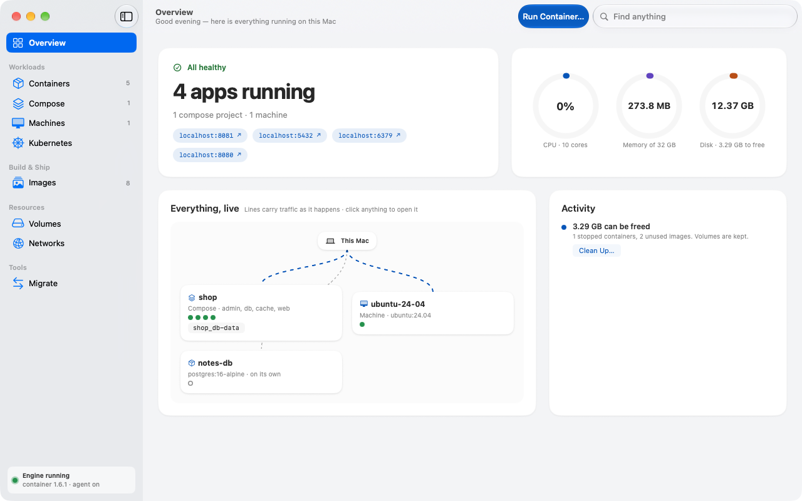
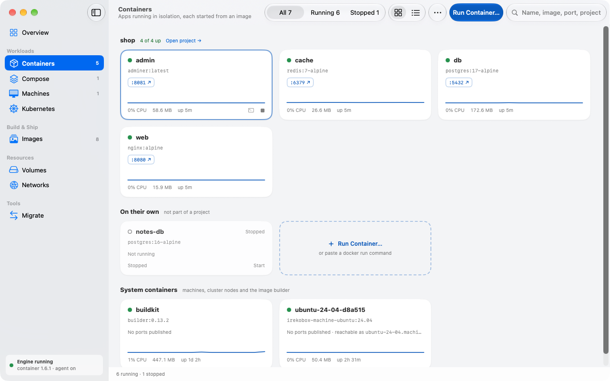
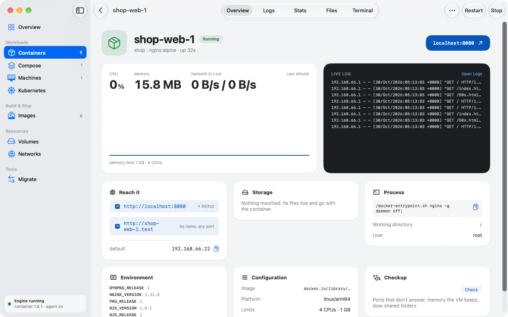
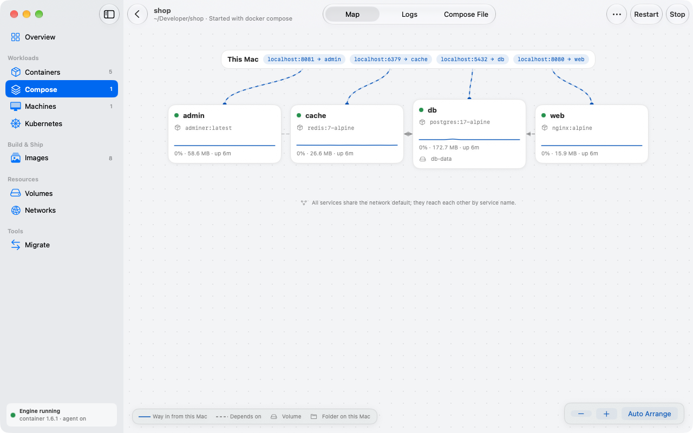

<p align="center"></p>

<h1 align="center">Irekobox</h1>

<p align="center">Linux containers on your Mac, without Docker Desktop.<br>
A native Mac app for <a href="https://github.com/apple/container">Apple’s <code>container</code></a>.</p>

<p align="center"><a href="https://irekobox.com">irekobox.com</a></p>



Apple’s `container` runs each Linux container in a lightweight virtual machine
of its own. It comes as a command-line tool; Irekobox gives it a window.

- **Containers.** Logs, a terminal, the container’s files and live CPU, memory
  and network charts on one page. Change a port or a variable and Irekobox
  recreates the container; the old one stays until the new one runs.
- **Compose.** Open a folder with a `compose.yaml`. Irekobox shows the services,
  their ports and dependencies, and before the first start reports what works,
  what it fixes for you and what `container` can’t do yet.
- **Machines.** Ubuntu, Debian, Fedora or Alpine with your account and home
  folder.
- **Kubernetes.** Local clusters: create one, add it to your kubeconfig, load
  your images, run an app.
- **Docker tools keep working.** Irekobox answers the Docker API on a socket of
  its own, so the `docker` CLI, Compose, Testcontainers and Dev Containers run
  on `container`. A migration assistant brings images, volumes, registry
  logins and Compose projects over from Docker Desktop.
- **And:** a background agent that restarts containers by their restart policy
  and brings them back at login, a menu bar extra, notifications, a command
  palette (⌘K), and an MCP server for AI coding assistants.

| | | |
|---|---|---|
|  |  |  |

## Requirements

- A Mac with Apple silicon
- macOS 26 or later
- Apple’s `container` 1.6 or later. Irekobox offers to install it if it’s
  missing.

## Install

With [Homebrew](https://brew.sh):

```sh
brew install sirruf/tap/irekobox
```

Or download the latest release from
[Releases](https://github.com/sirruf/irekobox/releases). Builds are signed with
a Developer ID, notarized by Apple, and update themselves.

## Privacy

Irekobox has no analytics and no account. It goes online only to:

- check `irekobox.com` for a new version of the app (once a day, release builds);
- check GitHub for a new version of `container` and download it when you ask;
- search Docker Hub when you search for an image, and talk to the registries
  you pull from or push to, including checks for newer versions of your images.

Registry passwords are kept in your Keychain.

## Why the name

*Ireko-bako* are Japanese nesting boxes: each holds a smaller one. Irekobox
puts your app in a container, the container in a small Linux VM, and the VM in
your Mac.

## Building

```sh
# Xcode 26+: SwiftTerm compiles a Metal shader, which needs the Metal Toolchain
xcodebuild -downloadComponent MetalToolchain

# Quick build and run (SwiftPM; no background agent in this mode)
swift build
swift run Irekobox

# Full app bundle with the background agent
xcodegen
xcodebuild build -project Irekobox.xcodeproj -scheme IrekoboxApp \
  -destination 'platform=macOS' -allowProvisioningUpdates
```

The Xcode project is generated from `project.yml` with
[XcodeGen](https://github.com/yonaskolb/XcodeGen) and is not checked in. To
build the full bundle under your own Apple developer team, replace
`YBKR9G3374` in `project.yml` with your team ID.

## Architecture

```
Irekobox.app ─────────────────────┐              IrekoboxAgent (LaunchAgent)
  SwiftUI (AppCore)               │   NSXPC      EngineStore: polling, snapshots, events
  EngineModel ◄───────────────────┼─────────────►  ContainerEngine
  (in-process EngineStore         │                ├─ XPCEngine → container-apiserver (libxpc)
   until the agent is connected)  │                └─ CLIEngine → `container` CLI (fallback)
```

- **ContainerKit** — the engine layer. `ContainerEngine` protocol with two
  backends: `XPCEngine` talks to `container-apiserver` over XPC (reads and
  simple lifecycle calls), `CLIEngine` runs the `container` CLI for everything
  else. `ManagedProcess` owns every child process (cancellation, timeouts,
  stderr draining).
- **EngineCore** (in the ContainerKit package) — `EngineStore`, the single
  polled source of truth: interest-driven polling, single-flight refreshes,
  last-good data with errors, and change events. Also the background agent’s
  XPC server and client.
- **DockerAPIKit** (in ContainerKit) — the Docker Engine API server.
- **IrekoboxAgent** — a LaunchAgent embedded in the app bundle and registered
  with `SMAppService`. It hosts the store so state stays current with the app
  closed.
- **ComposeKit / StackKit** — compose file parsing and planning, and running a
  plan as a stack.
- **MigrationKit** — moving from Docker (run-command translation, image and
  volume import).
- **AppCore** — the SwiftUI app; `Sources/Irekobox` is the thin `@main`.

## Tests

```sh
scripts/test-all.sh              # unit tests of the app and every package, plus lint
scripts/test-all.sh --live       # + contract tests against a running apiserver
scripts/test-all.sh --ui         # + the read-only XCUITest suite
scripts/run-mutation-uitests.sh  # UI tests that create and delete resources
```

Live tests need `container system start` first. Suites that create machines,
clusters or Compose projects, or read Docker Desktop, run only when asked: each
has its own `IREKOBOX_LIVE_*` variable, named at the top of its file.

UI tests need the U.S. keyboard layout; the mutation script selects it.

## Contributing

See [CONTRIBUTING.md](CONTRIBUTING.md). To report a security problem, see
[SECURITY.md](SECURITY.md).

## Support

Irekobox is free. If it saves you time, you can
[sponsor its development](https://github.com/sponsors/sirruf).

## License

Apache License 2.0. See [LICENSE](LICENSE).

Irekobox is not affiliated with Apple or Docker. “Docker” is a trademark of
Docker, Inc.
